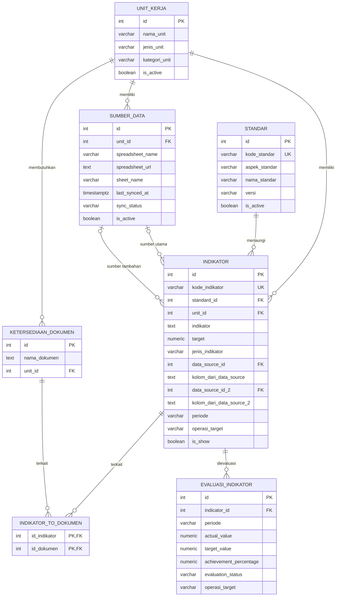

# Database Relationships — Sistem Monitoring SPMI

## 1. Gambaran Relasi Database

Diagram berikut menunjukkan hubungan antara tujuh tabel utama pada database monitoring SPMI.

## 2. Penjelasan Relasi

| Relasi                                | Kardinalitas | Penjelasan                                                                                         |
| ------------------------------------- | ------------ | -------------------------------------------------------------------------------------------------- |
| `unit_kerja` → `indikator`            | One-to-many  | Satu unit kerja dapat memiliki banyak indikator.                                                   |
| `standar` → `indikator`               | One-to-many  | Satu standar dapat menaungi banyak indikator.                                                      |
| `unit_kerja` → `sumber_data`          | One-to-many  | Satu unit kerja dapat memiliki banyak sumber data.                                                 |
| `sumber_data` → `indikator`           | One-to-many  | Satu sumber data dapat digunakan oleh banyak indikator, baik sebagai sumber utama maupun tambahan. |
| `unit_kerja` → `ketersediaan_dokumen` | One-to-many  | Satu unit kerja dapat memiliki banyak kebutuhan dokumen.                                           |
| `indikator` ↔ `ketersediaan_dokumen`  | Many-to-many | Hubungan indikator dan dokumen dikelola melalui tabel `indikator_to_dokumen`.                      |
| `indikator` → `evaluasi_indikator`    | One-to-many  | Satu indikator dapat memiliki evaluasi pada beberapa periode.                                      |

## 3. Keterangan Simbol

- `PK`: Primary key.
- `FK`: Foreign key.
- `UK`: Unique key.
- `||`: Tepat satu.
- `o|`: Nol atau satu.
- `o{`: Nol atau banyak.
- `|{`: Satu atau banyak.

## 4. Catatan

1. Relasi antara `indikator` dan `sumber_data` menggunakan dua foreign key: `data_source_id` dan `data_source_id_2`.
2. Relasi indikator dan dokumen bersifat many-to-many melalui `indikator_to_dokumen`.
3. Setiap kombinasi `indicator_id` dan `periode` hanya dapat muncul satu kali dalam `evaluasi_indikator`.
4. Diagram menggambarkan constraint relasional yang diberikan pada skema database. Aturan bisnis tambahan tidak otomatis tercermin dalam diagram ini.
